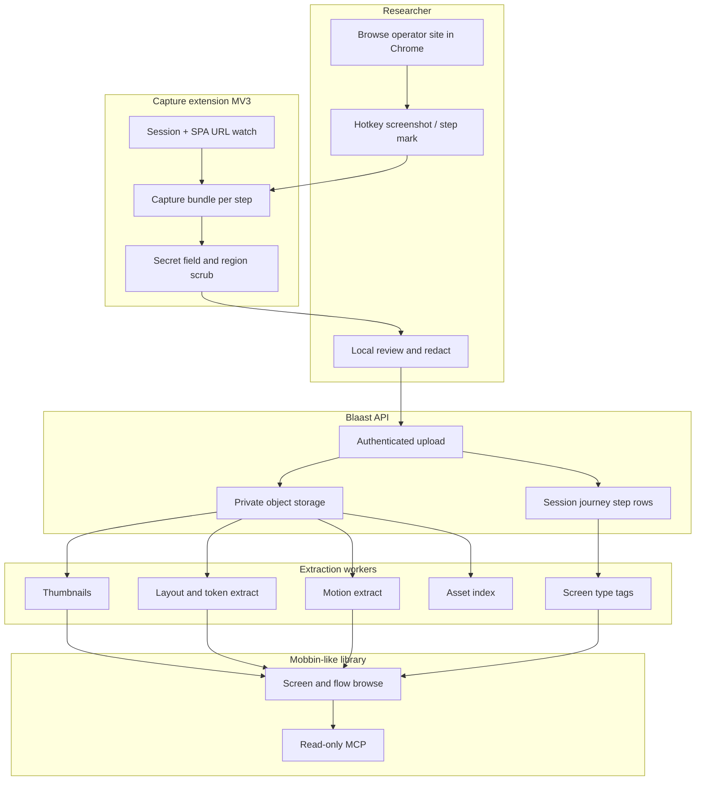

# Capture & extraction architecture

**Product:** Mobbin-for-iGaming library first.  
**Capture mode:** human-led Chrome MV3 + manual upload (Browserbase not used for library fill).  
**Goal:** **Same as Mobbin** — high-quality screenshots, ordered flows, tags, browse/search/MCP.  
**Also useful:** extract measured layouts/CSS/tokens (and later motion/assets) when the DOM allows — additive evidence, not a replacement for pixels. No perfect interactive clone of competitors.

### Brand capture policy (E2E-first)

1. **Brand sessions = end-to-end journeys** (`flowId` groups: home tour, place a bet, casino browse, deposit, onboarding…). Partial UI-only captures are not how a brand is marked complete.
2. **UI element beats are optional tags** inside a journey — they do not block Next or “Mark coverage done”.
3. **Add-on packs** (VIP reward, cashier gap, single surface) are available after brand E2E is underway — not a substitute for journeys.
4. **AI-in-the-loop (target):** human navigates one continuous recording + event timeline → auto screen/clip suggestions → researcher review queue. Today: guided journey steps + annotation enrich. Continuous-session segmentation is next, not a free crawl of every DOM node.

### Desktop + mobile (hireable script)

- **Mobile = mobile web** first (same operator URL). Native apps are a later track.
- **Two sessions per brand**, never flip desktop↔mobile mid-journey:
  1. Start **Desktop E2E** → locked ~1440×900 site window → finish required journeys → Mark coverage done.
  2. Start **Mobile E2E** → locked ~390×844 phone window → same journeys → done.
- Viewport presets: [`apps/web/src/lib/admin/viewport-presets.ts`](../apps/web/src/lib/admin/viewport-presets.ts). Artifacts stamp that viewport; session `platform` is `desktop_web` | `mobile_web`.
- **Keep human Chrome** for library fill. Do not use Browserbase/Playwright to drive operator sites (geo, KYC, bot blocks). Automation assists review/trim later; it does not replace the researcher browser.
- Freelancer loop: open operator → Desktop card → capture window → share site window → stop/tag/approve → repeat Mobile card.

---

## Honest fidelity model

| Layer | What we get | Label |
|-------|-------------|-------|
| Pixels (screenshot / video frame) | Exact visual of that viewport at that time | **measured** |
| Layout boxes + computed CSS | Exact for visible DOM elements via `getComputedStyle` / geometry | **measured** |
| CSS variables on `:root` / themes | Exact if present in DOM stylesheets/computed | **measured** |
| Animations (CSS / WAAPI) | Names, duration, easing, keyframe samples when readable | **measured** (partial on canvas/WebGL) |
| Images / icons (URLs + blobs) | Exact bytes when fetchable same-origin or via page context | **measured** (rights-gated) |
| Interaction behaviour | Click targets, nav sequence, focus order, open/close of sheets | **observed** |
| “Looks like token X” from a flat image | AI guess | **inferred** — never sold as source |
| Canvas / WebGL game frames | Pixels only; no CSS tree | **measured pixels**, styles **unavailable** |

**We do not promise bit-identical behaviour clones in the library.** The library is evidence + structured extraction. Interactive “make my betslip like X” is P2 studio on top of this evidence + customer tokens.

---

## End-to-end flow



---

## Capture layers (what the extension records per step)

### L0 — Session context
- `sessionId`, operator hint (hostname), started/stopped at  
- Platform: mobile|desktop viewport width/height/DPR  
- Permissions: origins explicitly allowed this session  
- Journey label (optional until review)

### L1 — Pixel evidence (required for Mobbin UX)
- Full-viewport PNG (preferred) or JPEG  
- Optional short clip around the step (phase 2)  
- Timestamp, URL, title, scrollY  

### L2 — Structure snapshot (required for tokens/layout)
- Lightweight DOM digest: visible interactive/landmark nodes only (cap N nodes)  
- For each node: tag, role, text hash (not raw PII), bounding box, selected computed styles  
- CSS custom properties from computed style on `documentElement` + key theme roots  
- **Never:** input values, password fields contents, cookies, localStorage, auth headers  

### L3 — Motion hints (phase 2)
- Running CSS animations/transitions on captured nodes  
- Optional `getAnimations()` sample  
- Flag `canvasOrWebgl: true` when detected (styles unavailable)

### L4 — Asset refs (phase 2)
- Visible `img`/`svg`/`background-image` URLs + content hashes when fetched in page world  
- Dedupe by hash; store privately; mark rights `uncleared` until review  

### L5 — Behaviour trail (lightweight)
- User-triggered events only while session active: click selector path (no values), SPA URL changes, viewport resize  
- Not a full rrweb replay in v1 (size + PII risk); optional later behind explicit toggle  

---

## Security gates (non-negotiable)

Aligned with [`.cursor/rules/security-capture.mdc`](../.cursor/rules/security-capture.mdc):

1. Explicit start/stop; per-site host permission.  
2. Strip or never read: `password`, `autocomplete` payment fields, hidden card inputs.  
3. Auto-flag payment/KYC URLs → require selective capture or skip recording.  
4. Local review UI before upload; researcher can paint-redact regions.  
5. Upload only after confirm; unpublished = org-private.  
6. Treat page DOM as untrusted (no eval of page scripts in privileged context beyond isolated content script).  

---

## Extraction workers (server-side)

Version every extractor (`extractorVersion`). Re-runnable; store provenance.

| Worker | Input | Output |
|--------|-------|--------|
| `thumb` | screenshot | webp thumbs, blurhash optional |
| `layout_tokens` | structure snapshot | `design_tokens[]` measured; layout tree summary |
| `classify` | screenshot + URL + DOM digest | screen-type tags from [`igaming-taxonomy.md`](./igaming-taxonomy.md) (AI assist + human confirm) |
| `motion` | motion hints + optional video | `motion_observations` |
| `assets` | asset refs | deduped asset records + signed URLs |
| `similarity` (later) | embeddings | related screens |

All AI outputs default to **`confidence` + `provenance: inferred`** until human confirms.

---

## Phased delivery

### Phase A — Mobbin core (ship this)
Extension: start/stop, screenshot, URL/viewport, redact, upload.  
Backend + UI: session → ordered flow → Mobbin-like grid/browse/tags.  
**Must feel like Mobbin** with screenshots alone.

**Admin guided coverage (in progress):** same taxonomy beats for every brand — instruction → 3-2-1 → short tab clip + poster → upload. See [`admin-capture-desk.md`](./admin-capture-desk.md) and `apps/web/src/lib/admin/coverage-pack.ts`.

### Phase B — CSS / tokens (useful add-on; already stubbed in extension)
Keep capturing structure snapshots with screenshots. Persist measured CSS variables + layout; show in a detail panel. Never block publishing a screen because tokens failed (e.g. canvas).

### Phase C — Animations like Mobbin ([changelog Nov 2025](https://mobbin.com/changelog/2025-11-12-introducing-animations))
Mobbin records interesting motion as **short videos** (not only CSS metadata), with an **Animations** browse tab, play/pause/scrub, and search filters. Homepage/discover carousels often autoplay those clips ([web latest](https://mobbin.com/discover/apps/web/latest)).

Blaast: same product shape — capture short clips when motion matters (betslip open, lobby carousels, claim confetti); library grid/detail plays video; Animations filter/tab. CSS `getAnimations()` remains an optional measured add-on, not a substitute for the clip.

### Phase D — Behaviour pack (optional, studio)
Reference-only interaction data; customer DS wins in generation.

---

## Repo layout (target)

```
apps/
  web/                 # Mobbin-like Next.js + shadcn library
  capture-extension/   # Chrome MV3
packages/
  capture-schema/      # Shared TypeScript types + zod
  extraction/          # Worker implementations (later)
```

Schemas live in [`packages/capture-schema`](../packages/capture-schema/). Extension scaffold in [`apps/capture-extension`](../apps/capture-extension/).

---

## Success criteria (capture pipeline)

- Researcher captures ≥3 steps on a permitted site without storing secrets.  
- Each step has screenshot + viewport + timestamp + URL.  
- Review/redact required before cloud.  
- Token values in library UI marked measured vs inferred.  
- Flow opens as ordered screens (Mobbin-style).  
- Extraction versions recorded; reprocessable.
