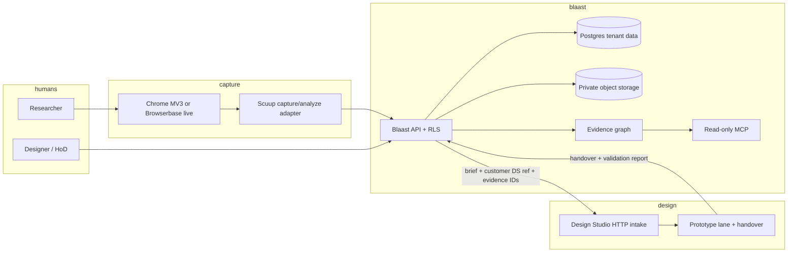

# Proposed architecture — iGaming Intelligence (post-audit)

**Status:** proposal for G0 approval. Validate against live Scuup RLS and chosen Design Studio path before build.

## Ownership boundaries

| System | Owns | Does not own |
|--------|------|--------------|
| **Blaast (new)** | Tenancy, operators, evidence graph, rights, MCP, product UI, orchestration | Raw Lumen tokens; BetOnline shell |
| **Scuup (existing)** | Capture runtimes, journey scoring, research IMAP (interim), SaaS patterns | Chrome MV3 (new); governed prototype |
| **Design Studio (existing)** | Governed prototype loop, lint, handover, design skills | Multi-tenant DS; research MCP |

## High-level data flow

## Module mapping

| PRD module | Primary home | Calls |
|------------|--------------|-------|
| M1 Operators | Blaast | May import Scuup brand rows |
| M2 Capture | **Chrome MV3** (`apps/capture-extension`) + extraction workers | Primary; Browserbase not for library |
| M3 Evidence | Blaast | Scuup storage pattern hardened |
| M4 Library | Blaast | — |
| M5 CRM | Blaast; Scuup IMAP interim | — |
| M6 Audits | Blaast | Scuup journey scores as input |
| M7 Benchmark | Blaast UI; Scuup rank/score libs | Adapter |
| M8 Design Studio | Design Studio via HTTP | Blaast supplies tenant DS + refs |
| M9 MCP | Blaast new server | May feed Design Agent as *client* later |
| M10 SaaS | Blaast; Scuup Stripe patterns | Adapter |

## Security baseline

- Default deny; `organisation_id` on tenant entities; real RLS (not service-role-only).  
- Signed short-lived artifact URLs; redact before AI.  
- Capture user-initiated; no passwords/cookies/payment fields stored.  
- Design Agent sandbox stays inside its repo; Blaast never ships competitor assets into customer prototypes.  
- Customer tokens/components outrank competitor references (enforce in brief + validation).

## Persistence

| Concern | Choice (proposed) |
|---------|-------------------|
| App DB | Supabase Postgres + RLS (Blaast-owned migrations) |
| Artifacts | Private bucket (R2 or Supabase private + signed URLs) |
| Jobs | Queue worker (start simple; avoid Design Studio in-memory queue for SaaS) |
| Design jobs | Remain in Design Studio files until adapter proves need to mirror status in Blaast |

## Open architecture forks (see decisions-needed.md)

1. Capture: Browserbase-first G1 vs MV3-first G1.  
2. Design path: Claude `apps/studio` vs Cursor live-site desk.  
3. Repo strategy: multi-root workspace vs monorepo later.
